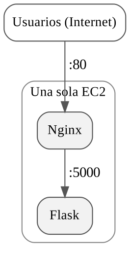
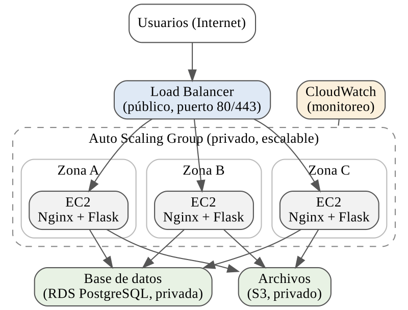

# Taller 6 - EC2 en una arquitectura escalable

Análisis de los límites de una sola EC2 y diseño de una arquitectura con Load Balancer, varias
instancias y Auto Scaling.

Enunciado: [`workshop_6_arquitecture_scalability.md`](workshop_6_arquitecture_scalability.md)
Evidencias y respuestas: [`evidencias-6-aws04.pdf`](evidencias-6-aws04.pdf)

## Índice de entregables

| Entregable solicitado | Dónde está |
|---|---|
| Diagrama de arquitectura | [`diagramas/arquitectura-propuesta.png`](diagramas/arquitectura-propuesta.png) + PDF |
| Respuestas de análisis | `evidencias-6-aws04.pdf` |
| Comparación una instancia vs múltiples | `evidencias-6-aws04.pdf` |
| Explicación de escalabilidad horizontal | `evidencias-6-aws04.pdf` |
| Propuesta de evolución hacia una arquitectura más administrada | `evidencias-6-aws04.pdf` |

Este taller es solo de análisis y diseño: no se usó la consola de AWS.

## Diagramas

| Arquitectura inicial | Arquitectura propuesta |
|---|---|
|  |  |
